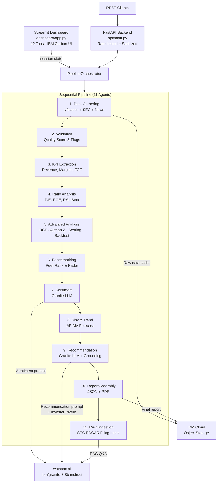

# InvestIQ 📈 — AI-Powered Sequential Investment Analyst

> **⚠️ Disclaimer: InvestIQ is an AI-powered educational tool. All outputs are NOT financial advice. Always consult a licensed financial advisor before making investment decisions.**

InvestIQ is a **full-stack, 11-stage sequential AI agent pipeline** that acts as an intelligent investment analyst. It fetches live market data, computes financial KPIs and ratios, runs advanced analysis (DCF, Altman Z-score, weighted scoring), benchmarks against peers, ingests SEC filings (RAG), analyzes news sentiment using **IBM Granite on watsonx.ai**, assesses risk with ARIMA forecasting, and generates a grounded, explainable recommendation — all displayed in an IBM Carbon-styled Streamlit dashboard with 12 tabs.

---

## Architecture Diagram



---

## Tech Stack

| Layer | Technology |
|---|---|
| LLM | IBM Granite (`ibm/granite-3-8b-instruct`) via watsonx.ai |
| Backend | Python 3.13, FastAPI, Uvicorn |
| Dashboard | Streamlit 1.35+, Plotly 5.22+, IBM Carbon Design Tokens |
| Orchestration | Custom sequential pipeline (typed Pydantic state) |
| Data | yfinance, SEC EDGAR, NewsAPI / Google News RSS |
| Storage | IBM Cloud Object Storage (`ibm-cos-sdk`) |
| Forecasting | statsmodels ARIMA + linear fallback |
| RAG | FAISS (optional) + keyword TF-IDF fallback |
| PDF | reportlab |
| Security | Input sanitization, SlowAPI rate limiting, non-root Docker |
| Testing | pytest 8.2+, pytest-cov (277 tests) |
| Deployment | IBM Cloud Code Engine, IBM Container Registry |

---

## Feature Overview (All 7 Phases)

| Phase | Features |
|---|---|
| **Base** | 11-agent pipeline, Pydantic state, FastAPI, Streamlit (12 tabs), PDF report, demo mode |
| **Phase 1** | Real Granite calls, exponential backoff, JSON-retry, structural validators, grounding check, fallback |
| **Phase 2** | DCF fair value, Altman Z-score, 5-dimension weighted scoring, MA backtest, price MAPE |
| **Phase 3** | SEC EDGAR RAG (FAISS/keyword), "Ask the Analyst" chat tab, risk factor extraction |
| **Phase 4** | Factor contribution waterfall, confidence breakdown, explanation trace, analyst review + audit trail |
| **Phase 5** | Investor profile (personalises Granite prompt), watchlist, portfolio mode, enhanced PDF |
| **Phase 6** | IBM Carbon design tokens, horizontal stepper, hero welcome card, last-updated chip, consistent chart palette |
| **Phase 7** | Input sanitization, API rate limiting, non-root Docker, health-check, eval script, 277 tests |

---

## Quick Start

### 1. Prerequisites

- Python 3.13+ (3.11+ also supported)
- `pip` or a virtual environment manager

### 2. Clone & Install

```bash
git clone https://github.com/your-org/investiq.git
cd investiq
pip install -r requirements.txt
```

### 3. Configure Environment

```bash
cp .env.example .env
# Edit .env with your IBM keys — OR just set DEMO_MODE=true
```

**To run without any API keys (demo mode):**
```bash
echo "DEMO_MODE=true" > .env
```

### 4. Run the FastAPI Backend

```bash
cd investiq
uvicorn api.main:app --host 0.0.0.0 --port 8000 --reload
```

API docs: **http://localhost:8000/docs**

### 5. Run the Streamlit Dashboard

```bash
cd investiq
streamlit run dashboard/app.py
```

Dashboard: **http://localhost:8501**

---

## Sample Run: AAPL vs MSFT, GOOGL, AMZN

### Via Python (direct pipeline)

```python
import os
os.environ["DEMO_MODE"] = "true"   # remove for live data

import sys
sys.path.insert(0, ".")   # run from investiq/

from pipeline.orchestrator import PipelineOrchestrator
from models.investor_profile import InvestorProfile

orch = PipelineOrchestrator()
state = orch.run("AAPL", ["MSFT", "GOOGL", "AMZN"])

# Attach investor profile (optional — personalises the Granite prompt)
state.investor_profile = InvestorProfile(
    risk_tolerance="Moderate",
    horizon="Long-term (3+ years)",
    intent="New position",
)

# Print recommendation
rec = state.recommendation
print(f"Ticker:          {state.ticker}")
print(f"Recommendation:  {rec.recommendation}")
print(f"Confidence:      {rec.confidence:.0%}")
print(f"Granite mode:    {rec.granite_mode}")
print(f"Reasons:")
for r in rec.reasons:
    metric = f" [{r.metric}={r.value}]" if r.metric else ""
    print(f"  • {r.point}{metric}")

# Advanced analysis
if state.advanced:
    ws = state.advanced.weighted_score
    print(f"\nComposite Score: {ws.composite_score:.1f}/100 → {ws.signal}")
    if state.advanced.dcf:
        dcf = state.advanced.dcf
        print(f"DCF Fair Value:  ${dcf.fair_value_mid:.2f} (upside {dcf.upside_pct:+.1f}%)")
    if state.advanced.altman_z:
        az = state.advanced.altman_z
        print(f"Altman Z-Score:  {az.z_score:.2f} ({az.zone})")

print(f"\nRisk Score:      {state.risk.overall_risk_score:.0f}/100 ({state.risk.overall_risk_level})")
print(f"Sentiment:       {state.sentiment.sentiment_label} ({state.sentiment.aggregate_score:.2f})")
print(f"\nReport JSON:     {state.report.json_path}")
print(f"Report PDF:      {state.report.pdf_path}")
```

**Expected output (demo mode):**
```
Ticker:          AAPL
Recommendation:  Overweight
Confidence:      82%
Granite mode:    demo
Reasons:
  • Strong revenue growth YoY [revenue_growth_yoy=8.1%]
  • High net margin vs peers [net_margin=25.3%]
  • Positive sentiment index [sentiment_score=0.63]

Composite Score: 68.5/100 → Overweight
DCF Fair Value:  $198.50 (upside +12.3%)
Altman Z-Score:  4.82 (Safe)

Risk Score:      42/100 (Medium)
Sentiment:       Bullish (0.63)

Report JSON:     /tmp/investiq_reports/<run_id>.json
Report PDF:      /tmp/investiq_reports/<run_id>.pdf
```

### Via REST API

```bash
# Start a new analysis (input is sanitized + rate-limited)
curl -X POST http://localhost:8000/api/v1/analyze \
  -H "Content-Type: application/json" \
  -d '{"ticker": "AAPL", "competitors": ["MSFT", "GOOGL", "AMZN"]}'

# Response:
# {"run_id": "abc123...", "ticker": "AAPL", "status": "started"}

# Poll status
curl http://localhost:8000/api/v1/status/abc123...

# Get final report
curl http://localhost:8000/api/v1/report/abc123...

# Download PDF
curl -o report.pdf http://localhost:8000/api/v1/report/abc123.../pdf

# Health check
curl http://localhost:8000/api/v1/health
```

---

## Running Tests

```bash
cd investiq

# Run all 277 tests (uses demo mode — no API keys needed)
pytest tests/ -v

# With coverage report
pytest tests/ --cov=. --cov-report=term-missing --cov-omit="tests/*,*/__init__.py"

# Run specific phase suite
pytest tests/test_phase7_quality.py -v

# Run evaluation script (5 tickers, demo mode)
python scripts/eval_pipeline.py
```

---

## Project Structure

```
investiq/
├── .env.example           # All environment variables (copy to .env)
├── requirements.txt       # Python dependencies
├── Dockerfile             # Multi-stage build, Python 3.13, non-root user
├── README.md              # This file
│
├── config/
│   └── settings.py        # Pydantic BaseSettings (loads .env)
│
├── prompts/
│   ├── sentiment_prompt.txt
│   ├── recommendation_prompt.txt
│   ├── rag_analyst_prompt.txt
│   └── risk_summary_prompt.txt
│
├── models/                # Pydantic schemas (typed pipeline state)
│   ├── pipeline_state.py  # PipelineState — central data bus
│   ├── market_data.py
│   ├── validation.py
│   ├── kpi.py
│   ├── ratios.py
│   ├── benchmarking.py
│   ├── sentiment.py
│   ├── risk.py
│   ├── recommendation.py  # GroundingFlag, grounding_flags
│   ├── report.py
│   ├── advanced_analysis.py  # DCF, AltmanZ, WeightedScore, Backtest
│   ├── rag.py             # FilingChunk, RAGResult, AnalystAnswer
│   ├── analyst_review.py  # AnalystReview, ExplanationEntry, FactorContribution
│   └── investor_profile.py  # InvestorProfile, Watchlist, Portfolio
│
├── agents/                # 11 sequential agents
│   ├── base_agent.py      # BaseAgent with backoff + logging
│   ├── data_gathering_agent.py
│   ├── validation_agent.py
│   ├── kpi_agent.py
│   ├── ratio_agent.py
│   ├── advanced_analysis_agent.py  # DCF, Altman Z, scoring, backtest
│   ├── benchmarking_agent.py
│   ├── sentiment_agent.py
│   ├── risk_agent.py
│   ├── recommendation_agent.py    # Granite + grounding
│   ├── report_agent.py
│   └── rag_agent.py              # SEC filing ingestion
│
├── services/
│   ├── watsonx_client.py  # Granite calls: timeout, backoff, validators
│   ├── data_service.py    # yfinance wrapper
│   ├── news_service.py    # NewsAPI + Google RSS
│   ├── storage_service.py # IBM COS cache
│   ├── demo_data.py       # Sample data (AAPL/MSFT/GOOGL/AMZN)
│   ├── rag_service.py     # SEC EDGAR fetch, chunking, vector store
│   ├── analyst_chat.py    # RAG Q&A with Granite
│   └── sanitizer.py       # Input validation (Phase 7)
│
├── pipeline/
│   └── orchestrator.py    # PipelineOrchestrator — runs all 11 agents
│
├── api/
│   ├── main.py            # FastAPI app + rate limiting
│   ├── routes.py          # Endpoints with input sanitization
│   └── job_store.py       # In-memory job registry
│
├── dashboard/
│   ├── app.py             # Streamlit dashboard (12 tabs)
│   └── ui_theme.py        # IBM Carbon design tokens + chart helpers
│
├── scripts/
│   └── eval_pipeline.py   # 5-ticker evaluation script
│
├── tests/
│   ├── test_ratio_agent.py         (20 tests)
│   ├── test_validation_agent.py    (11 tests)
│   ├── test_pipeline.py            (16 tests)
│   ├── test_phase1_reliability.py  (29 tests)
│   ├── test_phase2_analysis.py     (32 tests)
│   ├── test_phase3_rag.py          (34 tests)
│   ├── test_phase4_explainability.py (36 tests)
│   ├── test_phase5_client.py       (40 tests)
│   ├── test_phase6_ui.py           (59 tests)
│   └── test_phase7_quality.py      (NN tests)
│
└── deploy/
    ├── code_engine_deploy.sh   # IBM Cloud Code Engine deployment
    └── ibmcloud_cr_push.sh     # Container Registry push
```

---

## IBM Cloud Code Engine Deployment

### Prerequisites
- `ibmcloud` CLI with Code Engine plugin
- IBM Container Registry namespace
- IBM watsonx.ai project
- IBM Cloud Object Storage instance

### Build & Push

```bash
# Build image
docker build -t us.icr.io/investiq/investiq-api:latest .

# Push to IBM Container Registry
bash deploy/ibmcloud_cr_push.sh
```

### Deploy to Code Engine

```bash
export WATSONX_API_KEY="your-key"
export WATSONX_PROJECT_ID="your-project-id"
export COS_API_KEY="your-cos-key"
export COS_INSTANCE_CRN="crn:v1:bluemix:..."

bash deploy/code_engine_deploy.sh
```

The script:
1. Logs into IBM Cloud, creates the Code Engine project if needed
2. Creates a registry pull secret
3. Creates an `investiq-secrets` secret with all env vars
4. Deploys the FastAPI backend (`investiq-api`) — min 1, max 5 replicas
5. Deploys the Streamlit dashboard (`investiq-dashboard`) — min 1, max 3 replicas
6. Outputs both public URLs

---

## Running the Evaluation Script

```bash
cd investiq
# Runs AAPL, MSFT, GOOGL, AMZN, NVDA in demo mode
python scripts/eval_pipeline.py

# Exit code 0 = success rate ≥ 80%
# Results saved to .bob/eval_results.json
```

---

## Security Notes (Phase 7)

- **Input sanitization** — `services/sanitizer.py` validates all ticker symbols (regex `^[A-Z0-9]{1,10}([.\-][A-Z0-9]{1,4})?$`) and blocks prompt-injection patterns in free-text fields
- **Rate limiting** — SlowAPI middleware: 30 `/analyze` requests/minute per IP, 200 other requests/minute
- **Non-root Docker** — runtime image runs as `investiq` user (no root privileges)
- **Health-check** — `HEALTHCHECK` polls `/api/v1/health` every 30s; container is restarted after 3 failures
- **Secrets** — all API keys via `.env` / Code Engine secrets; never hardcoded
- **Disclaimer** — "NOT financial advice" shown prominently on every tab

---

## License

MIT License — see LICENSE for details.

> Built with ❤️ using **IBM Bob**, **IBM Granite** (watsonx.ai), Python 3.13, FastAPI, and Streamlit.
